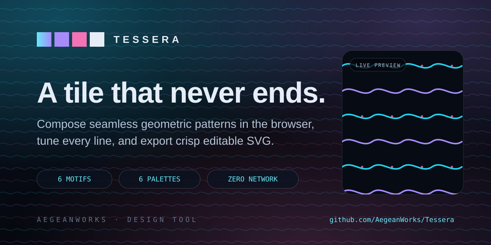

# Tessera

[](https://github.com/AegeanWorks/AIKit)

A seamless pattern studio: compose geometric tiles in the browser and export crisp SVG.



Tessera is a zero-dependency static studio. Six motifs and six palettes generate endless seamless tiles entirely in the browser: tune repeats, line weight and warp, reroll a seed, then export a clean, editable SVG or copy it to the clipboard. No uploads, no tracking and no network at runtime.

## ⚡ 30-Second Cold-Start Quick Reference

- **Runtime Prerequisites**: Node.js 20+ (tested on Node 26.9.0) for the local server and tests; any modern browser with ES modules, range inputs and `localStorage` for the studio. No `npm install`, no dependencies and no network.
- **Open the studio**:
  ```bash
  npm start          # serves http://127.0.0.1:4174/ and opens a browser
  ```
  On Windows you can double-click `play.cmd`; on macOS/Linux run `./play.sh`. Do not open `index.html` directly: browsers block ES modules from `file://`, so use a launcher or any static server.
- **Canonical Regression Shield Gate**:
  ```bash
  npm test
  ```
- **Static embed contract** (what the website copy enforces):
  ```bash
  npm run verify:static
  ```
- **UI inventory proof**:
  ```bash
  npm run ui:snapshot
  ```

### Controls

| Input | Action |
|---|---|
| Motif tiles | Switch between Wave, Ridge, Comb, Pinwheel, Arcade and Mosaic |
| Palettes | Recolor with Aegean, Kilim, Riso, Nocturne, Sage or Ember |
| Repeat / Line weight / Warp | Reshape the tile density, stroke weight and curvature |
| New seed | Reroll the generated variation without changing the motif |
| Glow drift / Tile guides | Animate hue subtly, or overlay the repeating tile grid |
| Presets | Load a curated motif and palette pairing |
| Randomize `R` | Jump to a new motif, palette and seed |
| Copy SVG `C` / Export SVG `E` | Copy the SVG source, or download it as a `.svg` file |

## What Is Tessera

Every pattern is one tile drawn in a `100 × 100` coordinate space and repeated with an SVG `<pattern>`. Because the tile is the unit of repetition, every motif is seamless by construction: the exported SVG contains a background rectangle, one `<pattern>` definition and no external references.

| Motif | Character |
|---|---|
| Wave | Layered sine lines with a hand-drawn swing |
| Ridge | A zigzag lattice with stitched peaks |
| Comb | A flat-top honeycomb that locks together |
| Pinwheel | Four folded sails around a bright core |
| Arcade | Concentric rings on a diamond lattice |
| Mosaic | A seeded tessera field with visible grout |

Each motif reads three arguments — a seeded random source, a line weight and a warp amount — and returns a list of primitive elements. Colors are palette *roles* (`ink`, `accent`, `highlight`, `paper`, `bg`), so a palette swap recolors props without touching geometry. Settings live in a single versioned localStorage record under `tessera.studio.v1`, mirrored in the URL query so a look can be shared or captured.

## What's Inside

```text
tessera/
├── .aikit/                    <- project memory: record, ledger, decisions
├── .gitattributes             <- CRLF for .cmd and LF for .sh
├── .gitignore                 <- transient state and caches excluded
├── COMMERCIAL.md              <- commercial licensing terms
├── LICENSE                    <- Aegean License 1.1 (AL-1.1)
├── LICENSES/                  <- REUSE license texts
├── README.md                  <- this living quick reference
├── REUSE.toml                 <- machine-readable SPDX metadata
├── index.html                 <- semantic studio shell
├── package.json               <- zero dependencies; start, test and inventory
├── play.cmd                   <- Windows one-click launcher
├── play.sh                    <- macOS/Linux one-click launcher
├── assets/
│   ├── logo.svg               <- square brand mark
│   └── social-preview.svg     <- 1280×640 social card
├── scripts/
│   ├── serve.mjs              <- static server, path containment, --open
│   ├── ui-inventory.mjs       <- stable data-ui / data-panel / data-cue inventory
│   └── verify-static.mjs      <- the static embed contract, shared with the tests
├── src/
│   ├── studio/
│   │   ├── motifs.js          <- six pure motif builders
│   │   ├── palettes.js        <- six palettes as color roles
│   │   ├── random.js          <- seeded mulberry32 generator
│   │   ├── state.js           <- normalization, presets, URL codec
│   │   ├── storage.js         <- one versioned localStorage record
│   │   └── svg.js             <- pattern and SVG serialization
│   ├── ui/
│   │   └── app.js             <- studio wiring, controls, export
│   ├── favicon.svg            <- tab mark
│   ├── styles.css             <- layout and motion using theme tokens
│   └── theme.css              <- the only file with raw color values
└── tests/
    ├── motifs.test.js         <- determinism, roles, tile ratios
    ├── palettes.test.js       <- complete role sets and fallbacks
    ├── random.test.js         <- replay, divergence, bounds
    ├── server.test.js         <- path containment, launchers, browser launch
    ├── state.test.js          <- clamping, presets, URL round-trips
    ├── static.test.js         <- the embed contract against fixtures
    ├── storage.test.js        <- versioning, corruption, hostile stores
    ├── svg.test.js            <- escaping, pattern output, palette roles
    └── ui.test.js             <- markup, controls, tokens, imports
```

## Design Decisions

- **Seamless by construction.** The tile is the only unit of repetition. No motif reaches outside `0–100`, so the `<pattern>` repeats with no seam and no post-processing.
- **Pure generator, thin UI.** `src/studio/*` has no DOM access; it takes a state record and returns SVG text. The UI only collects state and writes output, which keeps the whole rendering path testable in Node.
- **Roles, not colors.** Geometry names `ink`, `accent` and `highlight`; `palettes.js` resolves them. A palette swap cannot leave a stray hard-coded color behind, and a test proves it.
- **Versioned, bounded state.** `normalizeState` clamps every number, rejects unknown motifs and palettes, and accepts boolean spellings, so a hand-edited URL or an old record cannot break the studio.
- **Static by construction.** There is no API, no build step and no external asset. `index.html` and `src/` are the complete deployment payload.
- **Token-only styling.** Raw colors live in `src/theme.css`; `src/styles.css` reads custom properties, and a test rejects hex literals outside the theme.

## Screenshot QA

The studio accepts its full state as a query string, so any configuration can be captured without a driver:

| URL | State |
|---|---|
| `/?preset=aegean-tide` | The default wave preset |
| `/?preset=kilim-ridge` | Zigzag ridge in warm tones |
| `/?preset=riso-comb` | Honeycomb on warm paper |
| `/?preset=nocturne-pinwheel` | Pinwheel in lavender and ice |
| `/?preset=sage-mosaic` | Mosaic with visible grout |
| `/?motif=mosaic&palette=kilim&repeat=8&warp=80&seed=123` | Any explicit combination |
| `/?guides=1` | Tile guides overlay |

## Verification

- `npm test` runs the unit and integration suite with no browser and no network beyond loopback.
- `npm run verify:static` re-checks the embed contract the website sync enforces.
- `python aikit.py check tessera` runs the test, lint-adjacent hygiene, guidelines and secret gates.

## 📜 License

Free for personal use under the Aegean License 1.1 (AL-1.1); see [LICENSE](LICENSE). Any commercial use needs the Aegean Commercial License 1.0 (ACL-1.0); see [COMMERCIAL.md](COMMERCIAL.md).
